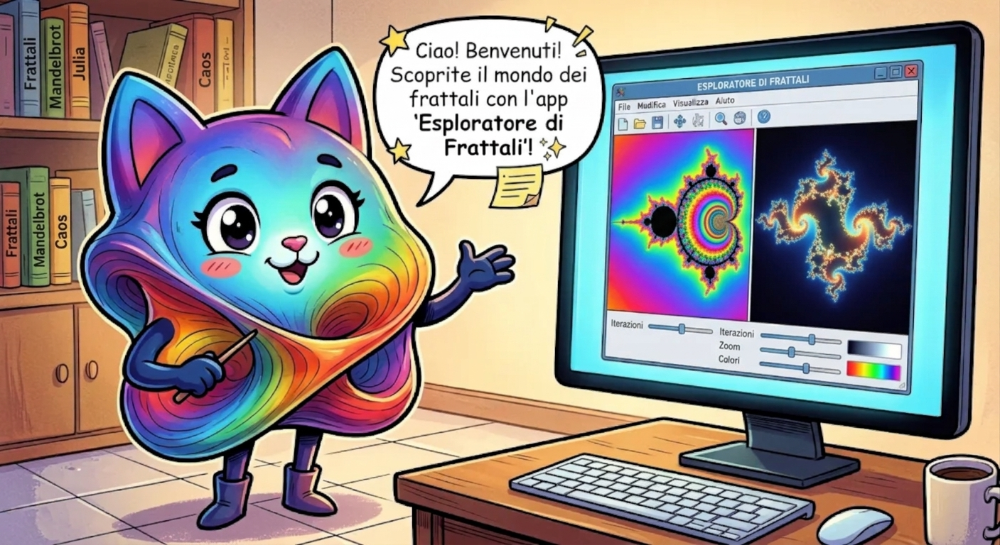

# Esploratore di Frattali — Guida Rapida

- code name: **fractal-explorer**

---

> 😺 **KubiMiao** 🐾

**Benvenuto!** Con **Esploratore di Frattali** (`fractal-explorer`) puoi esplorare direttamente nel browser il piano complesso, gli attrattori caotici e le figure geometriche ricorsive, passando in un attimo da una visione d'insieme a zoom profondissimi e personalizzando colori, luci e rilievi.

---

## 1. Cosa puoi fare con questa app
- **Esplorare 15 famiglie di frattali e sistemi dinamici:** dai grandi classici come *Mandelbrot*, *Julia* e *Burning Ship* ai metodi numerici (*Newton*, *Nova*), dalle mappe razionali e trascendenti (*Magnet*, *Esponenziale*, *Seno*, *Phoenix*) fino a *Buddhabrot*, *IFS/Chaos game*, *Attrattori strani*, *Biforcazione* e *Frattali geometrici*.
- **Spingere lo zoom fino all'estremo:** oltre il limite dei normali numeri del computer (circa $10^{13}$ ingrandimenti), il motore attiva automaticamente la precisione estesa fino a $10^{-250}$ su *Mandelbrot* e *Julia* ($d = 2$).
- **Confrontare più inquadrature insieme:** puoi affiancare fino a **4 viste** contemporanee sullo stesso frattale, visualizzando su ciascuna i riquadri delle altre per orientarti sempre.
- **Misurare e analizzare:** puoi leggere i dati matematici punto per punto con il cursore o un **marker**, tracciare un **profilo sezionale** lungo un segmento e ispezionarne i grafici.
- **Dipingere e illuminare i frattali:** hai a disposizione palette percettivamente uniformi, modi di colorazione basati sulla fase o sulla distanza dai filamenti, effetti di luce 3D e rilievo calcolati in tempo reale con accelerazione grafica WebGL2.
- **Condividere e sperimentare:** puoi copiare un link che racchiude esattamente la tua esplorazione, salvare immagini PNG, esportare lo stato in JSON o seguire gli esperimenti guidati nella **Guida didattica** in fondo alla pagina.

---

## 2. Primo sguardo all'interfaccia
All'apertura l'app mostra l'insieme di **Mandelbrot** nella sua vista intera:
- La **regione nera centrale** racchiude i punti che non sfuggono mai all'infinito durante il calcolo.
- Le **fasce colorate** intorno al bordo mostrano quanto velocemente i punti esterni si allontanano.
- In alto trovi l'intestazione con il pulsante **Condividi** (copia il link diretto alla vista corrente) e il collegamento alla **Guida - Ver. 1.17.0**.
- L'interfaccia si adatta automaticamente allo schermo: su computer hai il pannello dei controlli fisso di fianco alle viste; su smartphone in verticale i controlli si aprono dal basso; su schermi orizzontali bassi si aprono di lato.

---

## 3. Muoversi sul frattale in pochi gesti
- **Ingrandire (Zoom):** gira la **rotella del mouse** sul punto che ti interessa, fai **doppio clic** (o **doppio tocco** su schermo touch) per raddoppiare lo zoom, oppure usa i tasti `+` e `−`.
- **Zoom su un'area precisa:** trascina con il **tasto sinistro del mouse** per disegnare un rettangolo da ingrandire (`Esc` annulla). Su touch attiva prima **Zoom area** nella barra.
- **Spostarsi (Pan):** trascina con il **tasto destro o centrale** del mouse (oppure tenendo premuto **Spazio**), oppure trascina con **un dito** (o due dita mentre pizzichi per lo zoom) su touch.
- **Tornare indietro:** premi **Vista iniziale** (`R`) per tornare all'inquadratura di partenza, oppure **Indietro** (`B`) per annullare l'ultimo spostamento o cambio di stato.
- **Piazzare un marker:** fai un **clic singolo** (o un **tocco breve**) senza trascinare per fissare un segnaposto sul piano e leggerne i valori; un nuovo clic sullo stesso punto lo rimuove.

---

## 4. Tre idee da provare subito
1. **Dal Mandelbrot al suo «gemello» Julia:** piazza un marker vicino al bordo frastagliato del Mandelbrot, poi premi **Julia dal marker**. L'app passerà alla famiglia *Julia* generata proprio dalle coordinate del punto che hai scelto.
2. **Dare profondità 3D al frattale:** apri la scheda **Colore**, prova un **Modo esterno** come *Neon (filamenti)* o *Steli (germogli)*, poi apri **Luce e rilievo** e alza i cursori di **Luce** e **Rilievo** per trasformare il frattale in una superficie scolpita.
3. **Aprire due viste collegate:** imposta **Viste** su `2`, attiva **Cornici** e ingrandisci un dettaglio su una delle due viste. Vedrai comparire sull'altra vista il riquadro che indica dove ti trovi.

---

## Per saperne di più
Per la spiegazione completa di tutti i comandi, delle 15 famiglie, del profilo sezionale, dello zoom profondo e dei termini matematici e grafici usati nell'app, consulta il **`Manuale.md`** (oppure il [`Readme.md`](https://github.com/IK0VCK/fractal-explorer/blob/main/Readme.md) del progetto).
